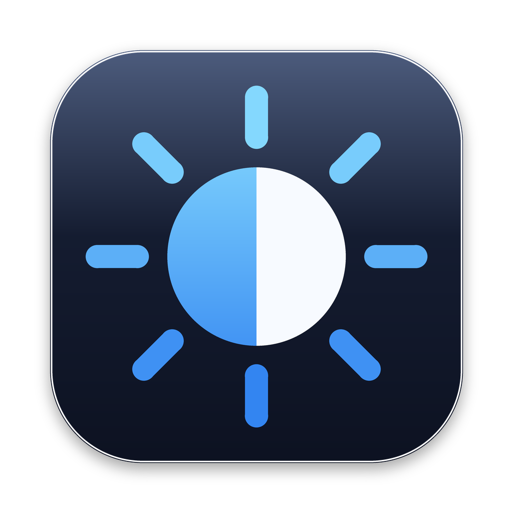

<p align="center">
  
</p>

<h1 align="center">Lumen</h1>

<p align="center">Brightness, contrast and volume for every display on your Mac, from the menu bar or your keyboard.</p>

<p align="center"><a href="https://github.com/9phfr6dsw4-dotcom/Lumen/releases/latest"><strong>Download the latest release</strong></a> · macOS 26+ · Apple Silicon</p>

<p align="center">
  <a href="https://github.com/9phfr6dsw4-dotcom/Lumen/releases/latest"></a>
  
  <a href="https://github.com/9phfr6dsw4-dotcom/Lumen/actions/workflows/macos-ci.yml"></a>
  <a href="LICENSE"></a>
</p>

## Features

- **Every display in one place.** Click the sun in the menu bar for a brightness slider for each screen, plus contrast and volume sliders for monitors that have them, and your presets one click away. Open Lumen for the full window, with tabs for Displays, Presets, Shortcuts and Settings.
- **Real monitor brightness.** External monitors change their own backlight over the video cable (DDC), just like pressing the buttons on the monitor, so the picture stays sharp and colors stay true. Your MacBook and Apple displays use macOS's own brightness control.
- **Works with every screen.** Monitors that can't be controlled directly (some HDMI ports, docks, adapters and TVs, AirPlay and Sidecar) are dimmed in software instead. Lumen works out which is which on its own; you can also choose for each monitor in **Displays**.
- **Darker than dark.** For late nights, the bottom quarter of the slider dims the picture further once a monitor reaches its lowest setting. The screen never goes fully black.
- **Your keyboard just works.** The brightness keys change the monitor under the pointer (or every display), and the volume keys control a monitor's speakers when your Mac's sound plays through them. Hold Option and Shift for finer steps.
- **Presets.** Day, Evening and Night set every display at once with one click or one shortcut. Add your own (up to 12), pick a symbol, reorder them, and restore the original three anytime. Presets fade in slowly, so the change is easy on your eyes.
- **Your own shortcuts** for Brighter, Dimmer and each preset. They work in every app, and Lumen warns you if two of them clash.
- **Gentle changes.** Brightness glides to its new level instead of jumping, and a small glass indicator shows the new level in the top-right corner of the screen you changed. Turn on **Move all displays together** to keep every screen at the same level.
- **Stays out of your way.** Lumen lives in the menu bar and opens when you log in. Its window and Dock icon only appear when you open them.
- **Updates itself.** Lumen checks for a new version when it starts and every hour, then installs it and reopens once any brightness change has finished. Turn this off, or check by hand, in **Settings → Updates** or with **Check for Updates…** in the menu.
- **Private.** No account and no tracking. Lumen only goes online to check GitHub for a new version.

## Install

1. Download `Lumen.zip` from the [latest release](https://github.com/9phfr6dsw4-dotcom/Lumen/releases/latest) and unzip it.
2. Drag **Lumen** into **Applications** (choose **Replace** when updating), then open it from there.
3. If macOS blocks it, open **System Settings → Privacy & Security** and choose **Open Anyway**. (Builds aren't notarized by Apple yet, so macOS asks on first launch.)
4. Lumen appears in the menu bar as a sun. To use your keyboard's brightness and volume keys on your monitors, allow Lumen in **System Settings → Privacy & Security → Accessibility** when it asks. The sliders, presets and your own shortcuts work without it.
5. **Updates install themselves** from 0.2.0 on. If the brightness keys stop working after an update, remove the old Lumen entry from the Accessibility list and turn on the new one.

You need an Apple Silicon Mac with macOS 26 or later.

## Shortcuts

| Keys | What they do |
|---|---|
| **Brightness keys** | Brighter or dimmer on the display with the pointer, or on every display (choose in **Shortcuts**). Needs Accessibility. |
| **Option + Shift + brightness keys** | The same in smaller steps. |
| **Volume keys** | Change the monitor's speakers when your Mac's sound output is set to that monitor. Otherwise they work as usual. Needs Accessibility. |
| **Your Brighter and Dimmer shortcuts** | Set them in **Shortcuts**. They change the same displays as the brightness keys and don't need Accessibility. |
| **Your preset shortcuts** | One for each preset, set in **Shortcuts**. |

Your MacBook and Apple displays keep their usual brightness keys.

## How it works

1. **Finding your displays.** Lumen asks each external monitor what it supports: brightness, contrast and volume. The answers decide which sliders you see.
2. **Monitors over DDC.** Most external monitors accept brightness, contrast and volume commands over their video cable (DDC/CI). Lumen sends them through macOS's display services on Apple Silicon. Some HDMI ports, docks and adapters don't pass these commands on.
3. **Software dimming.** A dark layer over the whole screen. It's used for screens that can't be controlled directly, and for the extra dimming below a monitor's minimum. Clicks pass straight through it.
4. **MacBook and Apple displays.** Lumen uses macOS's own brightness control, and the keyboard keeps working as usual on them.
5. **Remembering.** Each monitor's brightness and control choice is remembered by name and serial number, so it comes back the same after you reconnect it.

## Where your settings are

| What | Where | Notes |
|---|---|---|
| **Settings, presets, shortcuts and per-display levels** | `~/Library/Preferences/com.lumen.app.plist` | Managed by macOS. |

Lumen keeps no other files.

## Privacy

Everything runs on your Mac. Lumen has no account, no analytics, and doesn't connect to the internet.

<details>
<summary>Build and test</summary>

You need macOS 26 and Xcode 26.

```sh
swift test                       # tests
bash Scripts/package-app.sh      # build dist/Lumen.app and dist/Lumen.zip
bash Scripts/smoke-test.sh       # launch the packaged app from a clean copy
```

</details>

## License

MIT. See [LICENSE](LICENSE).
